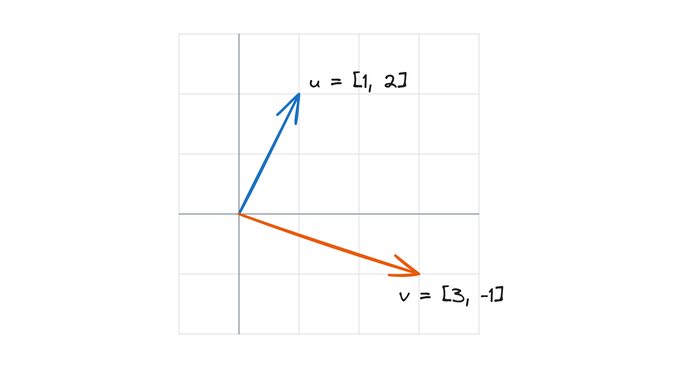
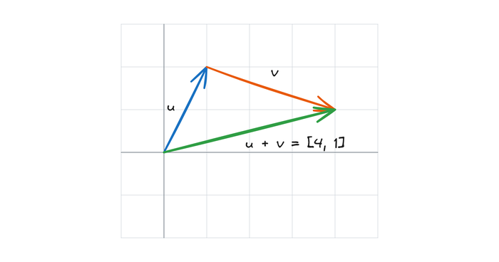
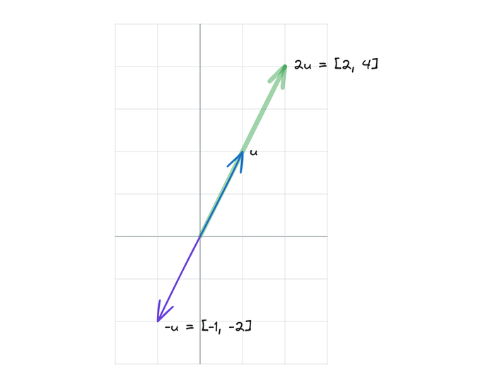
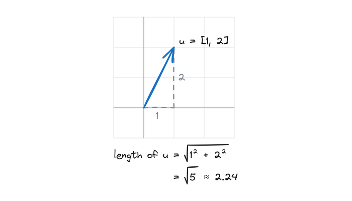
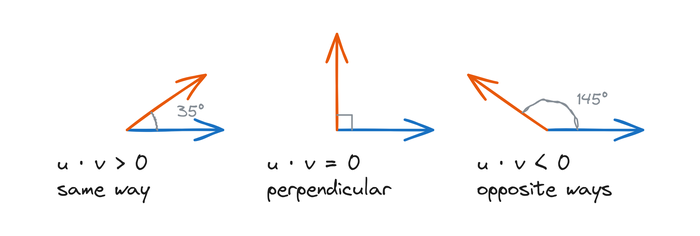
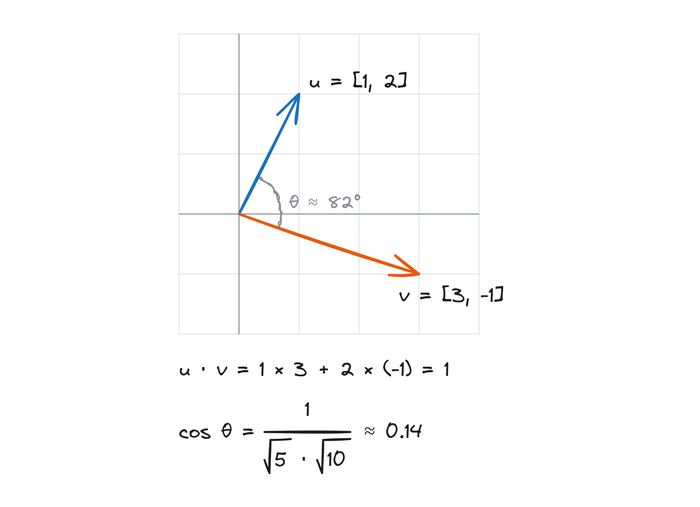
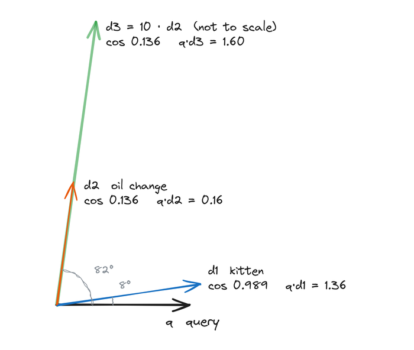

# 11.21.2026 - Math / Linear Algebra Notes - Vector and Similarity Search, By Hand

**Reading tip:** If you're already familiar with boring math like Vectors and dot products, feel free to [skip ahead](#a-similarity-search-by-hand). Then if you understand nothing, get back here, sit down, take a deep breath and read from the start.

## Vectors

A vector is an ordered list of real numbers. Geometrically, it can also be seen as an arrow pointing in some direction in space. It's usually written as a lowercase letter, like:

$$ u = \begin{bmatrix} 1 \\ 2 \end{bmatrix} \qquad v = \begin{bmatrix} 3 \\ -1 \end{bmatrix} $$

A vector with $n$ components is $n$-dimensional and lives in $\mathbb{R}^n$. For example, $u, v \in \mathbb{R}^2$. In practice, $n$ can be much larger: LLM embeddings often live in $\mathbb{R}^{768}$ or $\mathbb{R}^{4096}$, depending on the model.

When working with vectors, we use two basic operations:

_Addition_: add matching components:

$$ u + v = \begin{bmatrix} 1 + 3 \\ 2 - 1 \end{bmatrix} = \begin{bmatrix} 4 \\ 1 \end{bmatrix} $$

_Scaling_: multiply a vector by a number. This stretches or shrinks it along the same line (a negative number also flips its direction), which is why such numbers are called scalars:

$$ a u = a \begin{bmatrix} 1 \\ 2 \end{bmatrix} = \begin{bmatrix} a \\ 2a \end{bmatrix} $$

A vector's length, also called magnitude or norm, follows from the Pythagorean theorem: square each component, sum them, and take the square root:

$$ \|u\| = \sqrt{1^2 + 2^2} = \sqrt{5} \qquad \|v\| = \sqrt{3^2 + (-1)^2} = \sqrt{10} $$

## Dot product and cosine similarity

The dot product multiplies matching components and sums them. The result is a single number (a scalar), not a vector:

$$ u \cdot v = \sum_{i=1}^{n} u_i v_i = 1 \times 3 + 2 \times (-1) = 1 $$

In ML papers, it's often written as $u^T v$: transposing $u$ turns it into a row vector, and a row times a column gives the same sum:

$$ u^T v = \begin{bmatrix} 1 & 2 \end{bmatrix} \begin{bmatrix} 3 \\ -1 \end{bmatrix} = 1 $$

Geometrically, the dot product is tied to the angle $\theta$ between the two vectors:

$$ u \cdot v = \|u\| \|v\| \cos\theta \quad \Longrightarrow \quad \cos\theta = \frac{u \cdot v}{\|u\| \|v\|} $$

The sign of the dot product tells us whether two vectors point the same way:

- $u \cdot v > 0$: angle under $90^\circ$, roughly the same direction
- $u \cdot v = 0$: exactly $90^\circ$, perpendicular
- $u \cdot v < 0$: angle over $90^\circ$, roughly opposite directions

For our vectors, $\cos\theta = \frac{1}{\sqrt{5}\sqrt{10}} = \frac{1}{\sqrt{50}} \approx 0.14$, so $\theta \approx 82^\circ$, nearly perpendicular.

This is where _cosine similarity_ comes from: comparing two embeddings by $\cos\theta$ measures how closely their directions match, ignoring their lengths.

## A similarity search by hand

In a RAG system, every document is embedded and stored ahead of time. At query time, the question is embedded too, and the retriever compares its vector with each stored vector using cosine similarity, returning the closest matches. Let's run that search by hand.

### Step 0: Creating the data

In practice, embeddings come from a dedicated embedding model. Google's [EmbeddingGemma 2](https://huggingface.co/google/embeddinggemma-2), released in October 2026, turns each piece of text into a 768-dimensional vector. I don't know about you, but I'm not doing math in $\mathbb{R}^{768}$ by hand. Instead, let's make our own vectors in $\mathbb{R}^{4}$, with hand-picked numbers to keep the arithmetic clean, just enough to see how the examples relate to each other.

The query, _"How do I take care of a cat?"_, gets an arbitrary vector:

$$ q = \begin{bmatrix} 0.9 \\ 0.2 \\ -0.4 \\ 0.5 \end{bmatrix} $$

A related document, _"Feeding tips for a new kitten"_, should land near the query, so we take $q$ and add a little noise $\varepsilon$:

$$
d_1 = q + \varepsilon =
\begin{bmatrix} 0.9 \\ 0.2 \\ -0.4 \\ 0.5 \end{bmatrix} +
\begin{bmatrix} 0.1 \\ 0.1 \\ -0.1 \\ -0.1 \end{bmatrix} =
\begin{bmatrix} 1.0 \\ 0.3 \\ -0.5 \\ 0.4 \end{bmatrix}
$$

An unrelated document, _"How to change your car's oil"_, gets an independent vector:

$$ d_2 = \begin{bmatrix} 0.1 \\ 0.8 \\ 0.6 \\ 0.3 \end{bmatrix} $$

We expect $d_1$ to rank first. Let's check.

### Step 1: Dot products

We start by comparing the query $q$ with each document $d_1$ and $d_2$ using the dot product:

$$
\begin{aligned}
q \cdot d_1 &= (0.9)(1.0) + (0.2)(0.3) + (-0.4)(-0.5) + (0.5)(0.4) \\
            &= 0.9 + 0.06 + 0.2 + 0.2 \\
            &= 1.36
\end{aligned}
$$

$$
\begin{aligned}
q \cdot d_2 &= (0.9)(0.1) + (0.2)(0.8) + (-0.4)(0.6) + (0.5)(0.3) \\
            &= 0.09 + 0.16 - 0.24 + 0.15 \\
            &= 0.16
\end{aligned}
$$

The kitten document scores 1.36 against the oil change's 0.16, which is a clear lead. But the dot product also grows with the vector's lengths, so on its own it doesn't tell us how closely the *directions* match. For that, we need the lengths.

### Step 2: Norms

First, we find the length of the query vector $q$:

$$
\begin{aligned}
\|q\| &= \sqrt{0.9^2 + 0.2^2 + (-0.4)^2 + 0.5^2} \\
      &= \sqrt{0.81 + 0.04 + 0.16 + 0.25} \\
      &= \sqrt{1.26} \\
      &\approx 1.122
\end{aligned}
$$

Then the lengths of the two stored documents:

$$
\begin{aligned}
\|d_1\| &= \sqrt{1.0^2 + 0.3^2 + (-0.5)^2 + 0.4^2} \\
        &= \sqrt{1.00 + 0.09 + 0.25 + 0.16} \\
        &= \sqrt{1.50} \\
        &\approx 1.225 \\[1em]
\|d_2\| &= \sqrt{0.1^2 + 0.8^2 + 0.6^2 + 0.3^2} \\
        &= \sqrt{0.01 + 0.64 + 0.36 + 0.09} \\
        &= \sqrt{1.10} \\
        &\approx 1.049
\end{aligned}
$$

All three vectors are about the same length, a little over 1. Keep that in mind, we will discuss more about this later.

### Step 3: Cosine similarity

Now we have enough to calculate the cosine similarity and find the angle between $q$ and each document vector. For the kitten document $d_1$:

$$
\begin{aligned}
\cos(q, d_1) &= \frac{q \cdot d_1}{\|q\| \, \|d_1\|} \\
             &= \frac{1.36}{1.122 \times 1.225} \\
             &\approx \frac{1.36}{1.375} \\
             &\approx 0.989
\end{aligned}
$$

A cosine of 0.989 is very close to 1, the score for two vectors pointing in exactly the same direction. Taking the inverse cosine gives the angle between them: $\theta = \arccos(0.989) \approx 8^\circ$.

For the oil-change document:

$$
\begin{aligned}
\cos(q, d_2) &= \frac{q \cdot d_2}{\|q\| \, \|d_2\|} \\
             &= \frac{0.16}{1.122 \times 1.049} \\
             &\approx \frac{0.16}{1.177} \\
             &\approx 0.136
\end{aligned}
$$

This is close to 0, which means the vectors are nearly perpendicular: $\theta = \arccos(0.136) \approx 82^\circ$. The two vectors have almost nothing in common.

So the retriever returns $d_1$, the kitten document, just as we designed it to when we built $d_1$ from $q$ plus a little noise.

## What if the lengths differ?

In Step 2, we saw that all three vectors are about the same length. That's why we see the dot product and cosine similarity agree so far.

Real embeddings aren't always that tidy. Vectors from different models or model versions can sit at different scales, and a shortened vector that isn't normalized again (see EmbeddingGemma 2's [model card](https://huggingface.co/google/embeddinggemma-2#3-matryoshka-dimension-truncation)) ends up shorter than the rest.

To see what a length difference does to the ranking, let's exaggerate it: take the oil-change vector and make it 10 times longer, without changing its direction:

$$
d_3 = 10 \, d_2 = 10 \begin{bmatrix} 0.1 \\ 0.8 \\ 0.6 \\ 0.3 \end{bmatrix} = \begin{bmatrix} 1 \\ 8 \\ 6 \\ 3 \end{bmatrix}
$$

Its dot product with the query:

$$
\begin{aligned}
q \cdot d_3 &= (0.9)(1) + (0.2)(8) + (-0.4)(6) + (0.5)(3) \\
            &= 0.9 + 1.6 - 2.4 + 1.5 \\
            &= 1.6
\end{aligned}
$$

That's exactly $10 \times (q \cdot d_2)$, and it now beats the kitten document's 1.36. If we ranked by the raw dot product alone, a question about cats would return an article about oil changes, purely because its vector is longer.

Cosine similarity doesn't have this problem. Stretching $d_2$ by 10 multiplies both its dot product with $q$ and its length by 10, and since cosine similarity divides one by the other, the 10 cancels:

$$
\cos(q, d_3) = \frac{{\color{red}\cancel{\color{black}10}}\,(q \cdot d_2)}{\|q\| \cdot {\color{red}\cancel{\color{black}10}}\,\|d_2\|} = \frac{q \cdot d_2}{\|q\| \, \|d_2\|} = \cos(q, d_2) \approx 0.136
$$

The same is true for any stretch, because a vector's length always appears in both the numerator and the denominator. Cosine similarity scores only the direction a vector points, so no amount of stretching can push $d_3$ past $d_1$.

## Make it faster

Cosine similarity works, but look at what it costs: for every single comparison, we compute two lengths and divide. That's a lot of math! And the stored document's length never changes. So why not deal with the lengths once, up front, and be done with them?

The trick is to rescale every vector to length 1. Dividing a vector by its own length gives a *unit vector*: it points the same way, but its length is exactly 1. Usually written as a lower case letter with a hat on top.

For the query, divide each component by $\|q\| \approx 1.122$:

$$
\hat{q} = \frac{q}{\|q\|}
= \frac{1}{1.122} \begin{bmatrix} 0.9 \\ 0.2 \\ -0.4 \\ 0.5 \end{bmatrix}
\approx \begin{bmatrix} 0.802 \\ 0.178 \\ -0.356 \\ 0.445 \end{bmatrix}
$$

Same thing for the kitten document, this time dividing by $\|d_1\| \approx 1.225$:

$$
\hat{d}_1 = \frac{d_1}{\|d_1\|}
= \frac{1}{1.225} \begin{bmatrix} 1.0 \\ 0.3 \\ -0.5 \\ 0.4 \end{bmatrix}
\approx \begin{bmatrix} 0.816 \\ 0.245 \\ -0.408 \\ 0.327 \end{bmatrix}
$$

Now, remember the denominator of cosine similarity? It's the two lengths multiplied together, which is now just $1 \times 1 = 1$. Dividing by 1 does nothing, so the plain dot product *is* the cosine similarity. Don't trust me? Let's check:

$$
\begin{aligned}
\hat{q} \cdot \hat{d}_1 &= (0.802)(0.816) + (0.178)(0.245) + (-0.356)(-0.408) + (0.445)(0.327) \\
                        &\approx 0.654 + 0.044 + 0.145 + 0.146 \\
                        &\approx 0.989
\end{aligned}
$$

There it is: 0.989, the same number we got in Step 3, without computing a single length or dividing anything at search time.

This isn't just a trick to make hand calculations easier. In fact, you will see it on production everywhere. [OpenAI's embeddings](https://developers.openai.com/api/docs/guides/embeddings) already come out with length 1, so a plain dot product gives you the cosine similarity for free. [Qdrant](https://qdrant.tech/course/essentials/day-1/distance-metrics/) goes the other way around: pick cosine similarity for a collection, and it normalizes every vector the moment you upload it, then just runs dot products at search time.

## Results

|Document|Dot product|Cosine similarity|Angle|
|---|:-:|:-:|:-:|
|$d_1$: Feeding tips for a new kitten|1.36|0.989|$\approx 8^\circ$|
|$d_2$: How to change your car's oil|0.16|0.136|$\approx 82^\circ$|
|$d_3$: same as $d_2$, but $10\times$ longer|1.60|0.136|$\approx 82^\circ$|

The dot product mixes direction and length; cosine similarity measures direction alone. That's why RAG retrieval uses cosine similarity, or equivalently, the dot product on normalized vectors.
